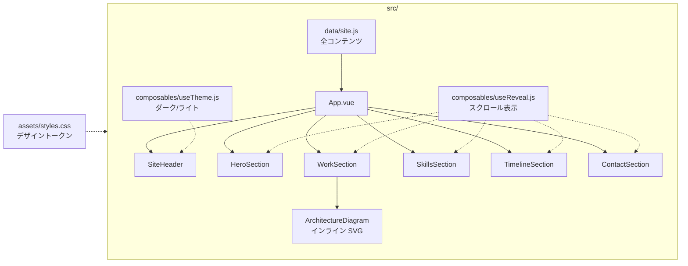
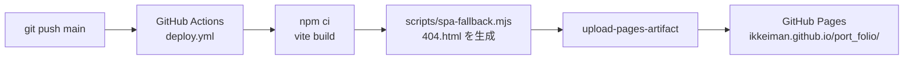

# Ikkei Miyata — Portfolio

宮田一慶のポートフォリオサイト。Vue 3 + Vite のみで構築し（UIフレームワーク不使用）、GitHub Pages で公開しています。

公開URL: https://ikkeiman.github.io/port_folio/

## 構成

```
src/
  data/site.js            全コンテンツ（文章・実績・スキル・年表）。更新はここだけ
  components/
    SiteHeader.vue        固定ヘッダー、セクション連動ナビ、テーマ切替
    HeroSection.vue       自己紹介と実績の数字
    WorkSection.vue       プロジェクト（課題 / やったこと / 結果）
    ArchitectureDiagram.vue  インラインSVGの構成図（テーマ色に追従）
    SkillsSection.vue     スキル・資格・受賞
    TimelineSection.vue   年表
    ContactSection.vue    連絡先
  composables/
    useReveal.js          IntersectionObserver によるスクロール表示
    useTheme.js           OS設定に追従するダーク/ライト切替（localStorage保存）
  assets/styles.css       デザイントークンとベーススタイル
```

## 構成図



文章・実績・スキル・年表はすべて `src/data/site.js` に集め、各セクションはそれを表示するだけにしています。内容の更新で触るファイルを1つに限定するためです。

### デプロイの流れ



- 外部ライブラリは Vue 本体のみ。フォントは Google Fonts（Inter / Noto Sans JP / JetBrains Mono）
- `prefers-reduced-motion` を尊重し、アニメーションを無効化できる
- 採用担当者にURLを直接渡す前提のため、`noindex` で検索エンジンには載せていない

## 開発

```sh
npm install
npm run dev
```

## ビルドとデプロイ

```sh
npm run build
```

`dist/` に出力されます。`main` ブランチに push すると GitHub Actions（`.github/workflows/deploy.yml`）が自動でビルドして GitHub Pages に公開します。
